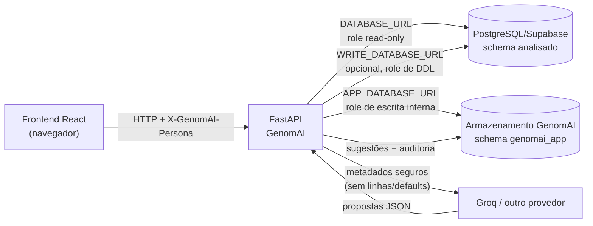

# GenomAI — catálogo, governança e documentação de dados

Backend FastAPI + frontend React para inspecionar a **estrutura** de um banco
PostgreSQL/Supabase, gerar recomendações, revisar sugestões com controle humano,
documentar o projeto e aplicar mudanças aprovadas com permissões por persona.

> **Princípio central:** a IA recebe apenas metadados seguros. Registros, valores
> de colunas, defaults e segredos nunca entram no payload. A IA também nunca
> executa mudanças no banco.

---

## O que a mentora pediu e o que foi entregue

| Pedido | Situação | Onde ver |
|---|---|---|
| "A integração ao banco está sendo via API?" | **Sim.** O navegador fala somente HTTP com a FastAPI; a FastAPI acessa o banco via SQLAlchemy no servidor. Não há credenciais nem acesso direto ao banco no frontend. | [Arquitetura](docs/visao-geral-arquitetura.md) |
| Botão **Editar** nas sugestões (inclusive parcialmente aprovadas) | **Entregue.** Edição versionada, reabre para revisão, histórico imutável. | [Guia do analista](docs/guia-analista-dados.md) |
| Alteração diretamente no BD **respeitando personas** | **Entregue (controlada).** Só `desenvolvedor`/`administrador` aplicam; somente SQL gerado pelo servidor (`CREATE INDEX`, `COMMENT ON`); exige aprovação, `DB_WRITE_ENABLED=true`, conexão de escrita dedicada e auditoria. | [Personas](docs/personas-permissoes.md) |
| Documentar código e projeto para analistas, devs e IA | **Entregue.** Guias específicos + referência da API + OpenAPI exportado. | [Índice da documentação](docs/README.md) |
| Sugestões no banco, não só no PC, e isoladas da IA | **Entregue.** Armazenamento interno em schema PostgreSQL próprio (`genomai_app`), conexão separada, exclusão das tabelas internas da análise e scripts de migração. | [Persistência e isolamento](docs/persistencia-e-isolamento.md) |
| Épico: não enviar dados pessoais/sensíveis à IA | **Entregue.** Allowlist de metadados, redação de identificadores, marcação de colunas sensíveis, prévia auditável e hash SHA-256. | [Privacidade da IA](docs/seguranca-privacidade-ia.md) |

---

## Arquitetura em uma imagem



Três conexões **nunca** compartilham engine, sessão ou credenciais:

1. `DATABASE_URL` — análise, somente leitura.
2. `APP_DATABASE_URL` — sugestões, revisões, auditorias.
3. `WRITE_DATABASE_URL` — opcional, apenas para aplicar mudanças aprovadas.

---

## Funcionalidades

- Catálogo de tabelas, colunas, chaves, índices, relacionamentos e amostra de
  registros (com paginação) em modo somente leitura.
- Análise determinística de qualidade estrutural.
- Análise com IA (Groq) usando **exclusivamente metadados seguros**.
- Revisão humana: aprovar, rejeitar, **aprovar parcialmente** e **editar**.
- Histórico versionado de cada edição (`suggestion_revisions`).
- Aplicação controlada de mudanças no banco, com preview do SQL e auditoria.
- Personas e capacidades aplicadas no backend.
- Diagnóstico de isolamento dos bancos (`/api/v1/system/storage`).
- Prévia exata do payload de IA (`/api/v1/privacy/ai-payload`).

---

## Início rápido (desenvolvimento)

### 1. Backend

```bash
python -m venv .venv
.venv\Scripts\activate
pip install -r requirements.txt
copy .env.example .env
uvicorn app.main:app --reload
```

Abra `http://127.0.0.1:8000/docs`.

No `.env`, configure:

```dotenv
DATABASE_URL=postgresql+psycopg://genomia_reader:<senha>@<host>:5432/<db>?sslmode=require
APP_DATABASE_URL=sqlite:///./genomai_app.db   # dev; em produção use PostgreSQL
```

> O SQLite serve para desenvolvimento. Para persistir as sugestões no banco,
> siga [Persistência e isolamento](docs/persistencia-e-isolamento.md).

### 2. Frontend

```bash
cd frontend
npm install
npm run dev
```

Abra `http://localhost:5173`. A URL da API pode ser alterada em
`frontend/.env` com `VITE_API_URL`.

### 3. Testes

```bash
python -m pytest -q
cd frontend && npm run build
```

---

## Personas

A persona é enviada no cabeçalho `X-GenomAI-Persona`. O backend é a barreira de
segurança; esconder botões no frontend é apenas conveniência.

| Persona | Consulta | Cria/edita | Revisa | Aplica no BD | Auditoria |
|---|---:|---:|---:|---:|---:|
| `leitor` | ✅ | — | — | — | — |
| `analista` | ✅ | ✅ | ✅ | — | — |
| `desenvolvedor` | ✅ | ✅ | ✅ | ✅ | ✅ |
| `administrador` | ✅ | ✅ | ✅ | ✅ | ✅ |

Detalhes e integração com autenticação real em
[docs/personas-permissoes.md](docs/personas-permissoes.md).

---

## Endpoints principais

| Método | Rota | Persona mínima | Para que serve |
|---|---|---|---|
| GET | `/health` | pública | Verifica a conexão com o banco analisado. |
| GET | `/api/v1/schema` | pública | Estrutura do banco (sem tabelas internas). |
| GET | `/api/v1/catalog/tables` | pública | Lista/pesquisa tabelas. |
| GET | `/api/v1/catalog/tables/{name}` | pública | Detalha uma tabela. |
| GET | `/api/v1/catalog/tables/{name}/rows` | pública | Pagina registros (modo leitura). |
| GET | `/api/v1/advisor/analyze` | pública | Regras determinísticas. |
| POST | `/api/v1/advisor/ai-analyze` | `analista` | Analisa com IA e salva propostas. |
| GET | `/api/v1/suggestions` | `leitor` | Lista sugestões. |
| POST | `/api/v1/suggestions` | `analista` | Cria sugestão. |
| PATCH | `/api/v1/suggestions/{id}` | `analista` | Edita e versiona. |
| POST | `/api/v1/suggestions/{id}/review` | `analista` | Aprova/rejeita/parcial. |
| GET | `/api/v1/suggestions/{id}/revisions` | `leitor` | Histórico. |
| GET | `/api/v1/suggestions/{id}/apply-preview` | `desenvolvedor` | SQL e bloqueios. |
| POST | `/api/v1/suggestions/{id}/apply` | `desenvolvedor` | Aplica mudança aprovada. |
| GET | `/api/v1/apply-logs` | `desenvolvedor` | Auditoria de aplicações. |
| GET | `/api/v1/personas` | `leitor` | Matriz de personas. |
| GET | `/api/v1/system/storage` | `leitor` | Diagnóstico de isolamento. |
| GET | `/api/v1/privacy/policy` | `leitor` | Política de privacidade da IA. |
| GET | `/api/v1/privacy/ai-payload` | `leitor` | Prévia do payload + SHA-256. |
| GET | `/api/v1/privacy/audits` | `leitor` | Histórico de envios (sem conteúdo). |

Referência completa: [docs/api-reference.md](docs/api-reference.md) e
[docs/openapi.json](docs/openapi.json).

---

## Variáveis de ambiente

| Variável | Padrão | Descrição |
|---|---|---|
| `DATABASE_URL` | obrigatória | Banco analisado, role **somente leitura**. |
| `DB_SCHEMA` | `public` | Schema analisado. |
| `APP_DATABASE_URL` | `sqlite:///./genomai_app.db` | Banco interno de sugestões. Em produção: PostgreSQL. |
| `APP_DB_SCHEMA` | `genomai_app` | Schema interno (ignorado no SQLite). |
| `APP_DB_AUTO_CREATE` | `true` | Cria schema/tabelas internas no startup. Em produção, prefira `false` após rodar o SQL. |
| `APP_STORE_REQUIRE_REMOTE` | `false` | Se `true`, recusa SQLite como armazenamento interno. |
| `ANALYSIS_EXCLUDED_TABLES` | `["suggestions",...]` | Tabelas que nunca entram na análise/IA. |
| `WRITE_DATABASE_URL` | vazio | Conexão de escrita dedicada, apenas para aplicar mudanças. |
| `DB_WRITE_ENABLED` | `false` | Habilita o endpoint de aplicação. |
| `DEFAULT_PERSONA` | `leitor` | Persona quando o cabeçalho não é enviado. |
| `AI_ENABLED` | `false` | Habilita a análise com IA. |
| `GROQ_API_KEY` | vazio | Chave do provedor; nunca versionar. |
| `GROQ_MODEL` | `openai/gpt-oss-20b` | Modelo usado. |
| `PRIVACY_MASK_SENSITIVE_IDENTIFIERS` | `false` | Pseudonimiza nomes de colunas sensíveis. |
| `PRIVACY_REDACT_DIGIT_RUNS` | `true` | Redige sequências de 6+ dígitos em identificadores. |

---

## Documentação

- [Índice da documentação](docs/README.md)
- [Visão geral da arquitetura](docs/visao-geral-arquitetura.md)
- [Guia do analista de dados](docs/guia-analista-dados.md)
- [Guia do desenvolvedor](docs/guia-desenvolvedor.md)
- [Guia para agentes de IA](docs/guia-ia.md)
- [Referência da API](docs/api-reference.md)
- [Mapa do código](docs/mapa-do-codigo.md)
- [Persistência e isolamento](docs/persistencia-e-isolamento.md)
- [Segurança e privacidade da IA](docs/seguranca-privacidade-ia.md)
- [Personas e permissões](docs/personas-permissoes.md)
- [Integração com outros bancos e IAs](docs/integracao-outros-bancos-e-ias.md)
- [Operação, testes e troubleshooting](docs/operacao-e-testes.md)
- [Decisões de arquitetura (ADRs)](docs/decisoes-arquiteturais.md)

---

## Limites atuais

- A persona é declarada por cabeçalho (demonstração). Em produção, troque a
  dependency por OIDC/JWT e mantenha a matriz de capacidades.
- A aplicação automática cobre `CREATE INDEX` e `COMMENT ON` em PostgreSQL; para
  outros tipos de mudança, o fluxo é revisão + aplicação manual.
- O frontend não tem autenticação própria; ele apenas envia a persona. O backend
  sempre valida.
- O armazenamento interno em SQLite é adequado para desenvolvimento, não para
  produção. Veja o checklist em [Persistência e isolamento](docs/persistencia-e-isolamento.md).
- A análise com IA depende da disponibilidade e dos limites do provedor.

---

## Segurança em uma frase

O GenomAI lê metadados, propõe mudanças e registra decisões; **quem aprova e quem
aplica são pessoas identificadas por persona**, e a IA nunca recebe dados de
linhas nem executa SQL.
