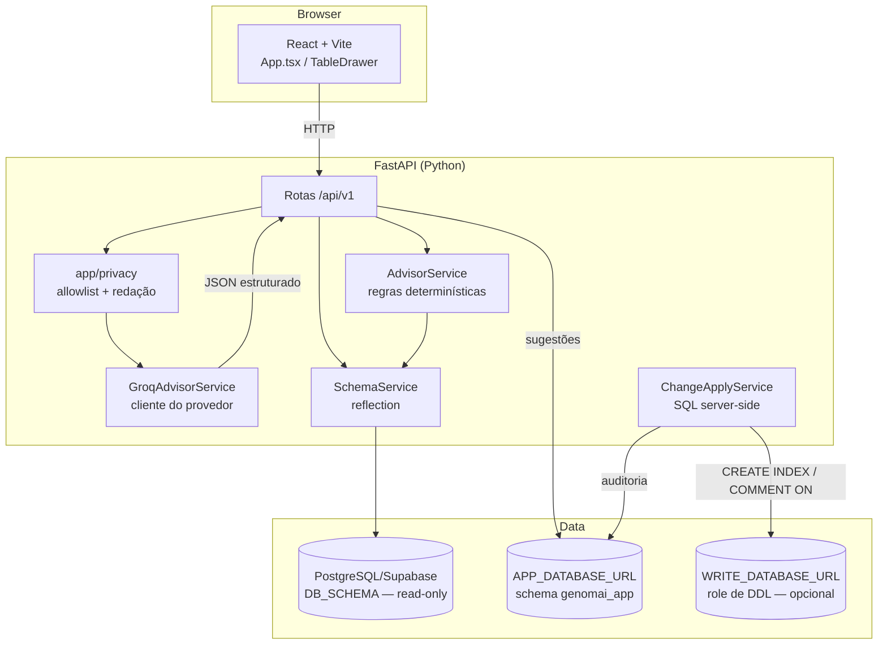

# Visão geral da arquitetura

## 1. Resposta direta à pergunta da mentora

> "A integração ao banco de dados está sendo via API?"

**Sim.** O frontend React não abre conexão com o banco. Ele chama a API FastAPI
por HTTP. A FastAPI usa SQLAlchemy no servidor para:

- ler metadados e (quando o usuário pede) amostras de registros;
- gravar sugestões, revisões e auditorias no armazenamento interno;
- opcionalmente aplicar mudanças aprovadas por uma conexão de escrita dedicada.

Credenciais ficam apenas no servidor (`.env`/secret manager), nunca no bundle do
frontend.

## 2. Componentes



## 3. Fluxos

### 3.1 Catálogo e análise determinística

1. `SchemaService` faz reflection do schema `DB_SCHEMA`.
2. Tabelas em `ANALYSIS_EXCLUDED_TABLES` são descartadas **antes** de qualquer
   exposição (catálogo, métricas, IA ou dados).
3. `AdvisorService` aplica regras (PK ausente, FK sem índice etc.).
4. A resposta é somente textual/JSON; nada é executado.

### 3.2 Análise com IA

1. O snapshot do schema é convertido por `build_safe_schema_context`.
2. A allowlist remove tudo que não seja metadado estrutural.
3. Identificadores são limpos e colunas sensíveis são marcadas.
4. `assert_safe_payload` falha se aparecer `rows`, `default`, `values` etc.
5. Um registro em `ai_metadata_audits` guarda **hash** e contagens.
6. O payload seguro é enviado ao provedor.
7. As propostas retornam como sugestões `pending` (nunca aplicadas).

### 3.3 Revisão e edição

1. A persona `analista` cria/edita/revisa.
2. Editar gera uma linha em `suggestion_revisions` e reabre a sugestão.
3. Aprovar/rejeitar/aprovar parcialmente só altera o estado; não toca no banco
   analisado.

### 3.4 Aplicação controlada

1. A persona `desenvolvedor`/`administrador` pede
   `GET /suggestions/{id}/apply-preview`.
2. O servidor valida tabela/coluna no snapshot e monta o SQL (nunca usa o SQL
   candidato da IA).
3. Se `DB_WRITE_ENABLED=true` e `WRITE_DATABASE_URL` existe, a aplicação executa
   em transação.
4. `apply_logs` registra persona, SQL, sucesso/falha e duração.
5. A sugestão recebe `applied_at`/`applied_by`.

## 4. Isolamento dos dados

O problema original: a tabela `public.suggestions` do Supabase (armazenamento
legado do próprio app) apareceu no catálogo e a IA gerou uma sugestão sobre o
índice dela. A correção tem três camadas:

1. **Conexão separada** — `DATABASE_URL` (read-only) vs `APP_DATABASE_URL`.
2. **Schema separado** — tabelas internas em `genomai_app`, nunca em `public`.
3. **Exclusão explícita** — `ANALYSIS_EXCLUDED_TABLES` remove `suggestions`,
   `suggestion_revisions`, `apply_logs` e `ai_metadata_audits` de qualquer
   snapshot, catálogo, métrica ou payload de IA.

O startup valida que `APP_DB_SCHEMA != DB_SCHEMA` quando o armazenamento é
PostgreSQL. Se a mesma URL/role for usada para os dois, o startup falha.

## 5. Estrutura de código

```text
app/
  api/v1/endpoints/       rotas finas (HTTP, validação, persona)
  core/config.py          configuração tipada
  core/personas.py        matriz de capacidades
  db/session.py           engine do banco analisado (read-only)
  db/app_session.py       engine do armazenamento interno + migrações leves
  db/write_session.py     engine de escrita opcional
  db/permissions.py       validação fail-closed da role PostgreSQL
  models/                 sugestões, revisões, auditoria
  privacy/metadata.py     allowlist/redação/auditoria do payload de IA
  services/               regras, reflection, leitura de linhas, aplicação
  schemas/schema.py       contratos Pydantic / OpenAPI
frontend/src/             React (App.tsx, TableDrawer.tsx, api.ts)
scripts/                  SQL de provisionamento, migração, validação
docs/                     esta documentação
tests/                    unitários e de integração
```

## 6. Decisões importantes

| Decisão | Motivo |
|---|---|
| Não usar o SQL candidato da IA para executar | O modelo é não confiável; o servidor gera SQL a partir de campos validados. |
| Reabrir sugestão ao editar | Garante nova decisão humana após qualquer ajuste. |
| Guardar hash do payload, não o payload | Auditoria sem duplicar metadados sensíveis. |
| Persona no cabeçalho | Demonstra a matriz sem acoplar o MVP a um provedor de identidade. |
| `ANALYSIS_EXCLUDED_TABLES` configurável | Protege contra tabelas internas em qualquer schema. |

## 7. Limites e evolução

- Trocar persona por OIDC/JWT é o próximo passo de produção.
- Para outros SGBDs, veja [Integração com outros bancos e IAs](integracao-outros-bancos-e-ias.md).
- Para outros provedores de IA, reutilize a camada `app/privacy` e implemente a
  mesma interface de análise.
